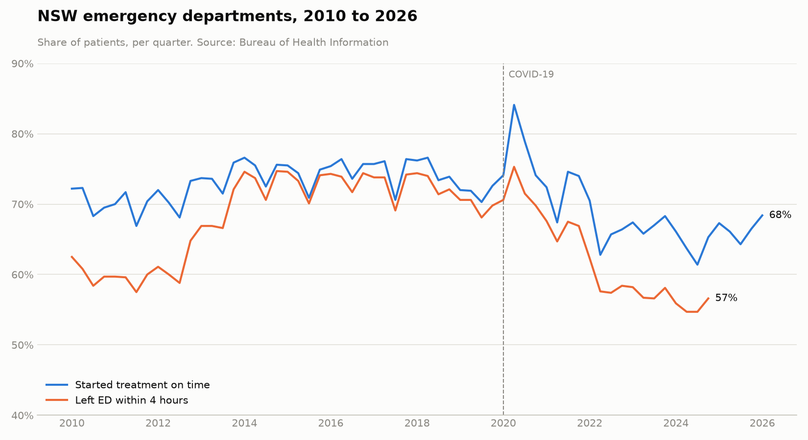
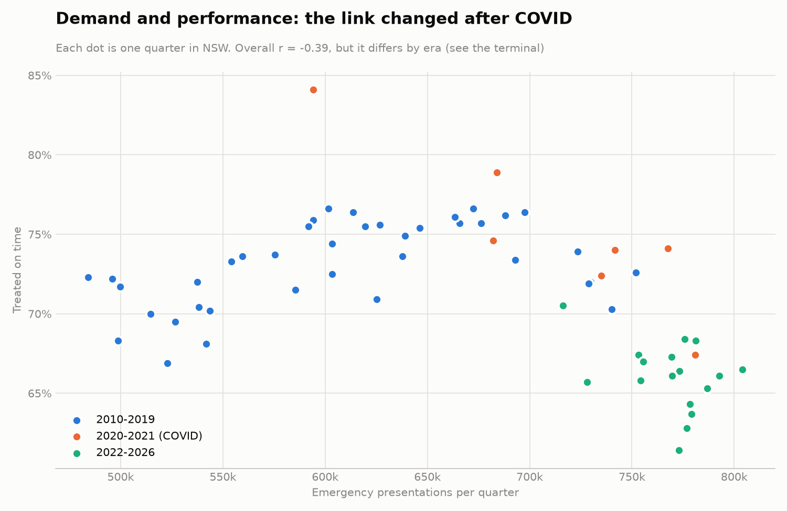
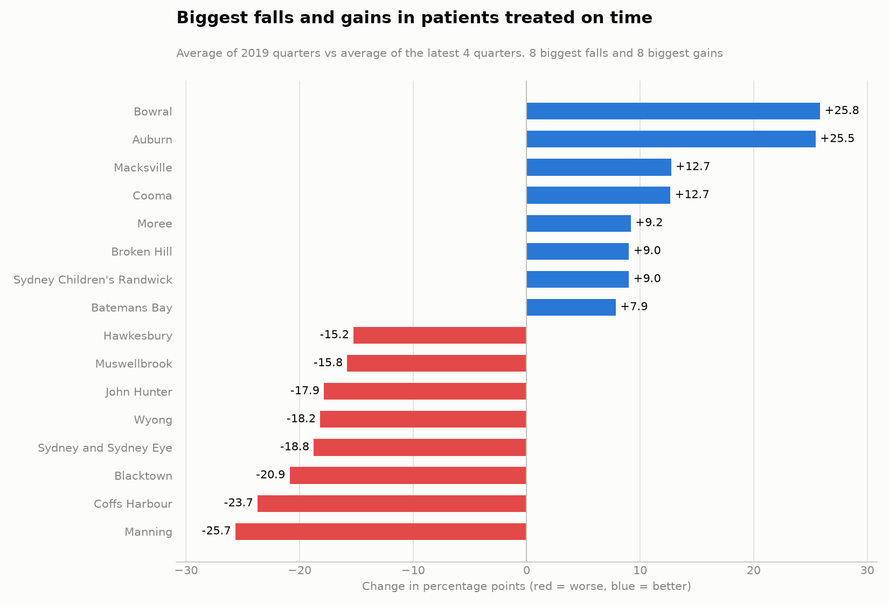
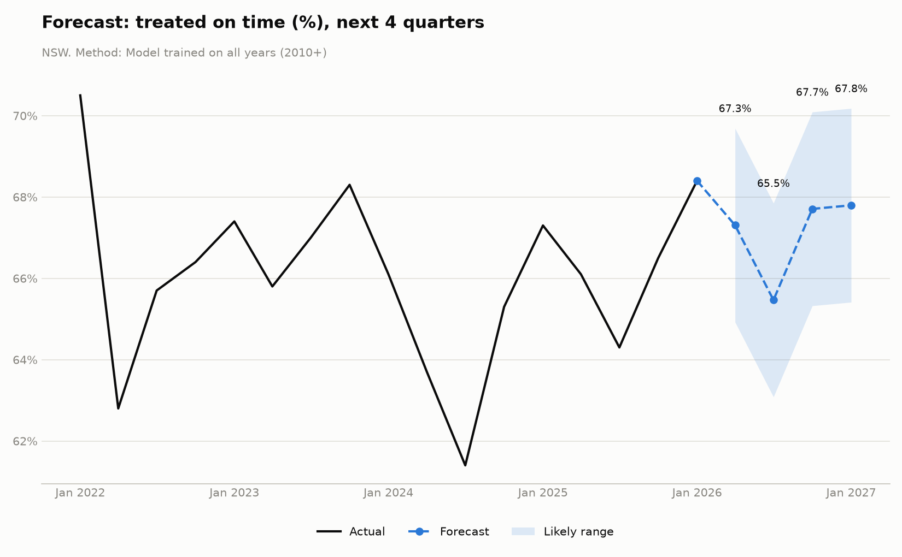

# 🏥 NSW ED Pressure Forecaster

An analysis and forecasting project using **16 years of real NSW emergency department data** (Jan–Mar 2010 to Jan–Mar 2026), with an interactive dashboard covering **80 hospitals** and **17 local health districts**.

**Questions it answers:** Are NSW emergency departments getting busier? Is performance getting better or worse? Which hospitals are struggling, and what will the next four quarters look like?



## Key findings

1. **Demand grew 56%.** Emergency presentations rose from about 496,000 to 776,000 per quarter between 2010 and 2026.
2. **Performance fell.** Patients starting treatment on time fell from 72.2% to 68.4%. The worst quarter on record was Jul–Sep 2024 (61.4%).
3. **COVID was a natural experiment.** In Apr–Jun 2020, presentations dropped about 20% during lockdown, and the share treated on time jumped to its best-ever level (84.1%).
4. **Winter is the hardest season.** In a typical Jul–Sep quarter, 69.3% of patients are treated on time, compared with about 72% in other seasons (COVID years excluded).
5. **The demand–performance link flipped after COVID.** Before 2020 the correlation was **+0.41** (demand and performance rose together); since 2022 it is **−0.37**. One overall number (−0.39) hides two opposite stories, which suggests a structural break.
6. **Hospitals diverged.** Comparing 2019 with the latest four quarters, 49 hospitals got worse and 23 improved. Manning fell from 76.6% to 50.9%; Bowral rose from 63.3% to 89.1%.





## Forecasting: tested, not assumed

I hid the last four quarters and asked four methods to predict them, then measured the average error (percentage points, smaller is better):

| Method | Average error |
|---|---|
| **Holt-Winters, trained on all years (2010+)** | **0.51** |
| Naive (repeat last quarter) | 1.53 |
| Seasonal naive (same quarter last year) | 1.90 |
| Holt-Winters, trained on recent years only (2022+) | 2.54 |

**My hypothesis was wrong.** After finding the structural break, I expected a model trained only on post-COVID data to win. It came last, probably because 13 quarters are too few to learn the seasonal pattern, and exponential smoothing already weights recent data more heavily. The test set is only four quarters, so these results should be read with caution.



## The dashboard

Pick NSW, any health district, or any hospital, then a measure. You see:
- the latest result, the NSW comparison and the hospital's rank
- the trend, with hover for exact values
- a four-quarter Holt-Winters forecast with a likely range
- a league table of all hospitals

Forecasts are only shown when the recent history is complete. Measures BHI discontinued after 2024 are labelled and not forecast.

## Data notes and honesty

- Source data is aggregated (hospital × quarter), not patient-level.
- Following BHI guidance, quarterly percentages and medians are **not** averaged into official yearly figures. Where four quarters are averaged (finding 6), it is a summary, not an official result.
- About 1.2% of hospital values are suppressed by BHI for small numbers. Some ambulance handover values are flagged "interpret with caution".
- BHI stopped two measures after Oct–Dec 2024 (4-hour and median time in ED) and introduced new time targets in 2025.
- Correlation is not causation. Staffing, new facilities and policy also changed over these years.

## Files

| File | What it does |
|---|---|
| `explore.py` | Loads the BHI Excel file; NSW trend, demand, and lowest-performing hospitals |
| `deeper.py` | Seasons, demand vs performance by era, hospital changes since 2019; saves `ed_clean.csv` |
| `forecast.py` | Fair test of 4 forecasting methods, then a 4-quarter forecast |
| `dashboard.py` | Interactive Streamlit dashboard |
| `ed_clean.csv` | Cleaned data used by the dashboard |

## Run it yourself

```bash
pip install -r requirements.txt
python -m streamlit run dashboard.py
```

To re-run `explore.py`, download the original Excel file from the BHI link below and save it as `bhi_ed_data.xlsx`.

## Data source

Bureau of Health Information. *Healthcare Quarterly – Emergency Department, Jan–Mar 2010 to Jan–Mar 2026.* Sydney (NSW); BHI: 2026. Date accessed: 14 October 2026. Available via [Data.NSW](https://data.nsw.gov.au/data/dataset/downloadable-data).

**Tech:** Python · pandas · matplotlib · statsmodels · Altair · Streamlit

---
Built by **Md Juman Hussan** · Master of Analytics, UNSW Sydney
